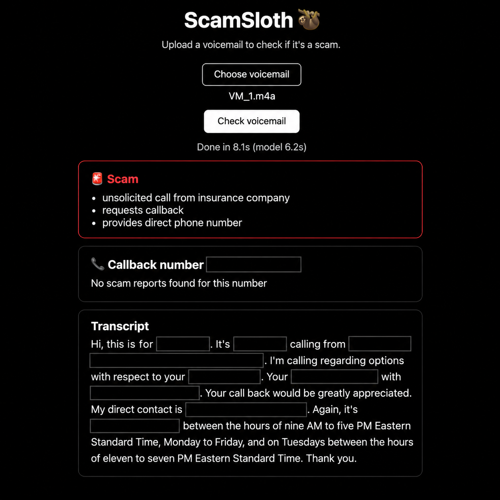
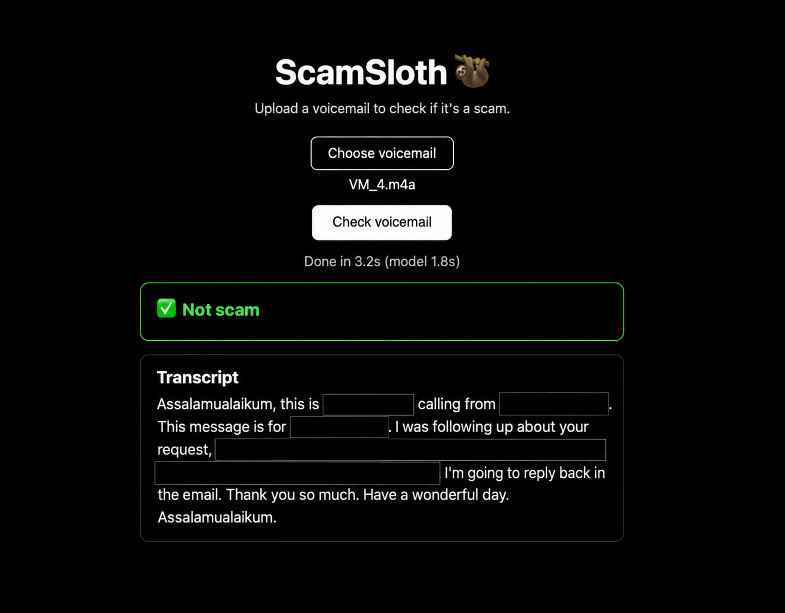

# ScamSloth 🦥

**ScamSloth listens to your voicemails so you don't have to.**

Upload a voicemail and in about 4 seconds you get:

- a **Scam / Not scam** verdict with red flags,
- a **callback-number check**, showing whether that number is reported as a scam online,
- the full **transcript**.

**Live:** https://scamslothis.mildlyintelligent.tech

| Scam                           | Not scam                               | Callback number                  |
| ------------------------------ | -------------------------------------- | -------------------------------- |
|  |  |  |

## How it works

1. **ElevenLabs Scribe** turns the voicemail audio into text.
2. **Qwen3.5-4B**, an open-weight model running on **Tinker**, reads the transcript and returns a verdict with red flags.
3. **SerpApi** searches the callback number for scam reports.
4. **FastAPI** serves it all, deployed on **Render**.

## Why open weights

A scam checker has to know about your life. While building ScamSloth, I tested it on my own voicemails, and it flagged one of my legitimate ones as a scam. The base model (Qwen3.5-4B) had no context on my life. If it had known my work history and which financial institutions I use, it wouldn't have flagged that call. The funny part is that the exact same voicemail sent to you could very well be a scam.

Generic models are great at a lot of things, but they don't know my data or my life. I see a future where intelligence works for everyone: open models with open weights, fine-tuned on each person's own data. Everyone gets intelligence customized for them, and without advertisers using that data to sell them stuff they don't need.

## Run it locally

Needs [uv](https://docs.astral.sh/uv/) and Python 3.12.

```
git clone https://github.com/bauji/scamslothis.git
cd scamslothis
uv sync
```

Create a `.env` file containing:

```
ELEVENLABS_API_KEY=...
TINKER_API_KEY=...
SERPAPI_API_KEY=...
```

Then run:

```
uv run uvicorn main:app --reload
```

and open http://127.0.0.1:8000.

## Roadmap

- Fine-tune Qwen3.5-4B on my own labelled voicemails, scored against the base model
- Make it an agent that decides when to look up a number, with Sentry tracing
- Swap ElevenLabs for an open speech-to-text model, and run inference locally

## License

MIT
